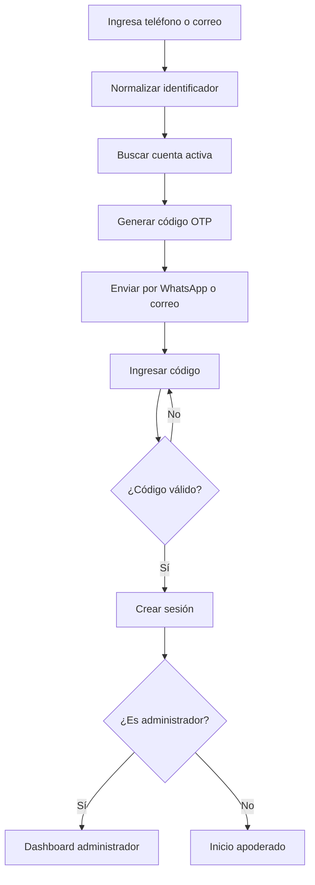
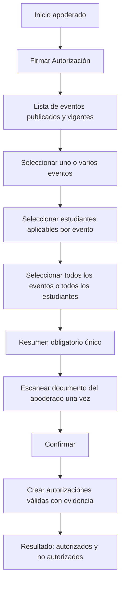
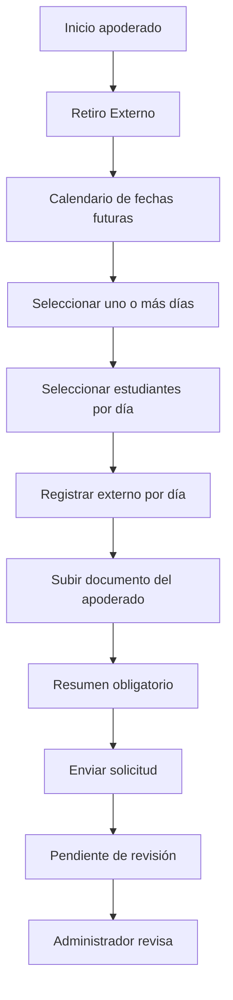
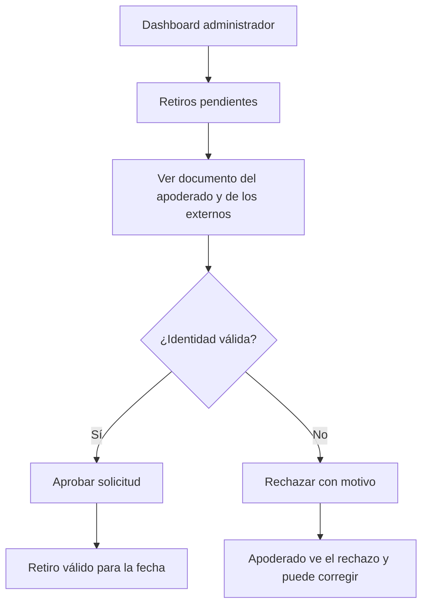
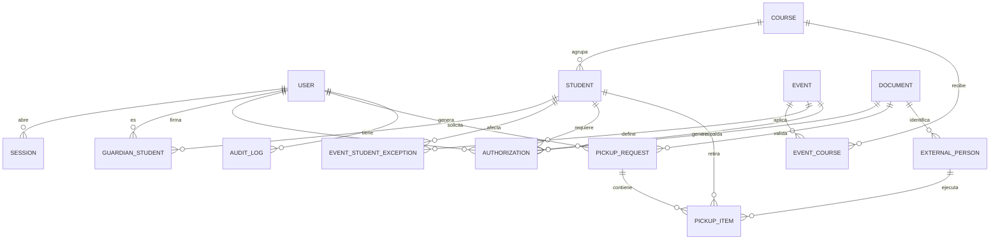

# Plataforma de Autorizaciones y Retiros

Documento de producto y contexto funcional para el desarrollo de la plataforma.

| Campo | Valor |
|---|---|
| Versión | 1.0 |
| Estado | Contexto inicial para desarrollo |
| Última actualización | 2026-11-01 |
| Fuente de verdad | Este documento |
| Alcance | Un colegio de educación básica en Chile |
| Volumen estimado | ~300 estudiantes |

> Este documento es la fuente de verdad funcional del proyecto. Si una decisión cambia, se actualiza aquí antes de modificar el código o los artefactos de OpenSpec.

---

## 1. Resumen ejecutivo

La plataforma es una aplicación web para un colegio de educación básica en Chile. Permite que los apoderados firmen autorizaciones para eventos —salidas, vacunas y otros— y autoricen el retiro de sus estudiantes por parte de personas externas, sin necesidad de instalar una aplicación móvil.

El acceso es sin contraseña: el apoderado ingresa su número de teléfono o correo electrónico, ya registrado en la base de datos del colegio, y recibe un código de verificación (OTP) por WhatsApp o correo electrónico. Los profesores y administradores usan el mismo mecanismo de acceso, pero su cuenta tiene permisos de administración y accede a un dashboard.

La plataforma debe ser simple, mobile-first y funcionar correctamente en navegadores móviles, incluido el navegador interno de WhatsApp.

---

## 2. Contexto y problema

El colegio necesita gestionar dos procesos que hoy suelen depender de papeles, mensajes y planillas:

1. **Autorizaciones para eventos.** Los apoderados deben autorizar la participación de sus estudiantes en salidas, vacunaciones y otras actividades. Las autorizaciones físicas se pierden, llegan tarde o no queda claro qué autorizó cada apoderado.
2. **Retiro de estudiantes por personas externas.** Cuando una persona distinta del apoderado retira a un estudiante, el colegio necesita registrar quién es, qué día retirará y con qué documento se identifica.

La solución debe evitar fricción para los apoderados. Por eso se descarta una aplicación nativa y se opta por una plataforma web accesible desde cualquier navegador.

---

## 3. Objetivos

- Digitalizar la firma de autorizaciones para eventos.
- Registrar y validar solicitudes de retiro externo.
- Entregar al colegio visibilidad de quiénes faltan por firmar y quiénes retirarán a los estudiantes.
- Mantener evidencia trazable de cada autorización y cada retiro.
- Reducir la carga administrativa de los profesores.
- Permitir el acceso sin instalación de aplicaciones y sin contraseñas.
- Diseñar una base simple que pueda mantenerse por un equipo pequeño.

---

## 4. Fuera de alcance

Estas capacidades no forman parte de esta tarea:

- Plataforma multi-colegio o multi-tenant.
- Aplicación móvil nativa.
- Reconocimiento automático de documentos (OCR) o lectura de códigos PDF417.
- Firma electrónica avanzada con proveedor certificado.
- Notificaciones masivas, recordatorios automáticos o avisos por retiro.
- Integración automática con SIGE u otro sistema escolar.
- Implementación completa de la capa de seguridad.
- Módulo de pagos, transporte, asistencia o notas.
- Administración de múltiples años escolares en paralelo.

La capa de seguridad se documenta como **diseño objetivo** en la sección 12, pero no se implementa en esta oportunidad.

---

## 5. Usuarios y roles

### 5.1 Apoderado

Persona vinculada a uno o más estudiantes. Puede ser padre, madre, tutor o apoderado legal. Un estudiante puede tener más de un apoderado con acceso; uno de ellos se marca como principal.

Puede:

- Iniciar sesión con su teléfono o correo registrado.
- Ver los eventos próximos que aplican a sus estudiantes.
- Firmar autorizaciones para uno, varios o todos sus estudiantes aplicables.
- Solicitar retiros externos para uno o varios días.
- Registrar distintos externos para distintos días.
- Subir su documento de identidad y el documento de identidad de cada externo.
- Ver el estado de sus solicitudes.

No puede ver información de estudiantes que no le pertenecen.

### 5.2 Profesor o administrador

Usuario del colegio con permisos de administración. Usa el mismo login que un apoderado, pero su cuenta tiene la marca de administrador.

Puede:

- Ver el dashboard de eventos y retiros.
- Ver cuántos estudiantes faltan por firmar y quiénes son.
- Ver los retiros solicitados, la identidad del externo y los documentos asociados.
- Aprobar o rechazar solicitudes de retiro.
- Crear y editar eventos.
- Importar datos desde CSV.
- Administrar estudiantes, apoderados y cursos de forma básica.
- Auditar y anular autorizaciones con motivo.

### 5.3 Persona externa

No es un usuario de la plataforma. Es un dato asociado a una solicitud de retiro: nombre, documento de identidad, parentesco y fotografía del documento. El externo no inicia sesión ni accede a la plataforma.

---

## 6. Alcance funcional

### 6.1 Inicio de sesión

1. El usuario ingresa su número de teléfono o correo electrónico.
2. El sistema normaliza el identificador:
   - Teléfono en formato E.164, por ejemplo `+56912345678`.
   - Correo electrónico en minúsculas.
3. El sistema busca una cuenta activa asociada.
4. Se genera un código de verificación de seis dígitos.
5. El código se envía por WhatsApp si el usuario ingresó un teléfono, o por correo electrónico si ingresó un correo.
6. El usuario ingresa el código.
7. Si el código es correcto, se crea una sesión y se redirige según el rol:
   - Apoderado: inicio con los dos botones principales.
   - Administrador: dashboard.

La respuesta al solicitar el código debe ser genérica para no revelar si el identificador existe o no.

En desarrollo, el envío por WhatsApp se reemplaza por un proveedor simulado que registra el código en el log local. El proveedor definitivo se decide antes del piloto.

### 6.2 Inicio del apoderado

La pantalla principal muestra dos botones grandes y claramente diferenciados:

- **Firmar Autorización**
- **Retiro Externo**

El diseño debe ser mobile-first, con áreas táctiles amplias y texto legible.

### 6.3 Autorizaciones para eventos

1. El apoderado entra a **Firmar Autorización**.
2. Se muestra una lista de eventos publicados y vigentes que aplican a al menos uno de sus estudiantes. Si el evento aún no ha ocurrido y todos los estudiantes aplicables del apoderado ya tienen autorización vigente, el evento permanece visible y se marca como **Estudiantes Autorizados**.
3. El apoderado puede seleccionar uno o varios eventos. El botón **Seleccionar todos los eventos** selecciona todos los pares estudiante–evento aplicables.
4. Dentro de cada evento se muestra el listado de estudiantes del apoderado que aplican. Puede seleccionar estudiantes individualmente o usar el botón **Seleccionar todos**.
5. Los pares que ya tienen una autorización vigente se muestran como **Ya autorizada** y no se pueden volver a seleccionar.
6. Antes de confirmar, el sistema muestra obligatoriamente un resumen único de todas las autorizaciones seleccionadas:
   - Nombre del evento.
   - Fecha y hora.
   - Estudiante.
   - Propósito o texto de la autorización.
   - Fecha límite para firmar.
7. El apoderado debe subir o capturar una fotografía de su documento de identidad una sola vez por envío, aunque el lote incluya varios eventos o estudiantes.
8. Al confirmar, se crea una autorización por cada par estudiante–evento válido, con evidencia de la firma.
9. Si un par deja de ser válido al confirmar, se crean los pares válidos y el resultado informa cuáles quedaron autorizados y cuáles no, con el motivo.
10. La autorización queda válida al enviarse. El administrador puede auditarla o anularla con motivo.

Si un estudiante ya tiene una autorización vigente para ese evento, el sistema no la duplica y lo informa. Si la autorización fue anulada, el apoderado puede firmar una nueva y la anulada se conserva en la auditoría.

### 6.4 Retiro externo

1. El apoderado entra a **Retiro Externo**.
2. Se muestra un calendario con fechas futuras habilitadas.
3. El apoderado puede seleccionar uno o varios días.
4. Para cada día seleccionado:
   - Selecciona uno o más estudiantes.
   - Registra al externo que retirará a esos estudiantes: nombres, apellidos, RUT o pasaporte, parentesco y fotografía del documento de identidad.
   - Puede usar el botón **Todos los estudiantes que apliquen** para seleccionar a todos sus estudiantes para ese día.
5. Si distintos días tienen distintos externos, se registran por separado.
6. El apoderado sube una sola vez su propio documento de identidad para validar la solicitud completa.
7. Antes de enviar, el sistema muestra obligatoriamente un resumen de:
   - Días seleccionados.
   - Estudiantes por día.
   - Externo asignado a cada día.
   - Propósito del retiro.
8. Al confirmar, la solicitud queda en estado **Pendiente de revisión**.
9. Un administrador revisa el documento del apoderado y los documentos de los externos.
10. El administrador aprueba o rechaza la solicitud con un motivo.
11. La solicitud solo es válida para la fecha indicada si está aprobada.

El calendario **no permite bloquear fechas manualmente**. Solo se inhabilitan las fechas pasadas. La ventana de fechas futuras es configurable; el valor inicial propuesto es de 60 días.

### 6.5 Dashboard del administrador

El dashboard muestra:

- Menú **Eventos** con los eventos publicados y cerrados que aún no ocurren, del mes actual y del mes siguiente, filtrables por curso.
- Para cada evento:
  - Total de estudiantes aplicables.
  - Cantidad de estudiantes que ya firmaron.
  - Cantidad de estudiantes que faltan por firmar.
  - Listado de estudiantes pendientes y sus apoderados.
- Retiros solicitados, filtrables por fecha y estado:
  - Estudiante.
  - Apoderado solicitante.
  - Día de retiro.
  - Externo: nombre, RUT o pasaporte y documento de identidad.
  - Estado de la solicitud.
- Acciones de revisión:
  - Aprobar.
  - Rechazar con motivo.
  - Ver documentos.
- Creación y edición de eventos:
  - Título.
  - Tipo: salida, vacunación u otro.
  - Descripción.
  - Ubicación.
  - Fecha y hora de inicio y término.
  - Texto de autorización.
  - Fecha límite para firmar.
  - Cursos a los que aplica.
  - Inclusiones o exclusiones individuales.
  - Estado: borrador, publicado, cerrado o cancelado.

### 6.6 Importación y administración básica

- Importación de cursos, estudiantes y apoderados desde CSV.
- Validación previa con reporte de errores por fila.
- Carga transaccional.
- Modo upsert: actualiza registros existentes y crea nuevos, pero no elimina.
- CRUD básico para corregir casos puntuales.
- Plantillas CSV descargables.

Columnas mínimas propuestas:

- Cursos: `nombre_curso`, `nivel`, `año`.
- Estudiantes: `tipo_documento`, `numero_documento`, `nombres`, `apellido_paterno`, `apellido_materno`, `nombre_curso`.
- Apoderados: `tipo_documento`, `numero_documento`, `nombres`, `apellido_paterno`, `apellido_materno`, `email`, `telefono`, `parentesco`, `numero_documento_estudiante`, `es_principal`.

---

## 7. Flujos principales

### 7.1 Login



### 7.2 Firma de autorizaciones



### 7.3 Solicitud de retiro externo



### 7.4 Revisión del administrador



---

## 8. Reglas de negocio

Estas reglas son obligatorias y deben estar cubiertas por tests cuando se implementen.

### Acceso y alcance

1. Solo usuarios activos con teléfono o correo registrado pueden autenticarse.
2. Un apoderado solo puede ver y operar sobre los estudiantes vinculados a su cuenta.
3. Un administrador puede ver todos los estudiantes, eventos y retiros.
4. El rol de administrador se valida en el servidor; nunca se confía en el cliente.

### Eventos y autorizaciones

5. Un evento solo es visible para apoderados cuando está en estado **Publicado**.
6. Un evento aplica a los cursos definidos, más las inclusiones individuales, menos las exclusiones individuales.
7. Un apoderado solo puede firmar por estudiantes que le pertenecen y que sean aplicables al evento.
8. Solo existe una autorización vigente por estudiante y evento. Si ya está firmada y vigente, no se duplica. Si fue anulada, el apoderado puede firmar una nueva y la anulada se conserva en la auditoría.
9. Solo se puede firmar antes de la fecha límite del evento.
10. Antes de confirmar, el sistema muestra obligatoriamente el resumen de todas las autorizaciones seleccionadas: evento, fecha, estudiante y propósito.
11. La autorización requiere documento de identidad del apoderado y registra evidencia: fecha y hora, IP, user agent, sesión OTP, documento y snapshot del texto de autorización.
12. La autorización queda válida al enviarse. El administrador puede auditarla o anularla con motivo.
13. El botón **Todos los aplicables** selecciona solo estudiantes del apoderado que aplican al evento, nunca estudiantes de otros apoderados.

### Retiros externos

14. El calendario solo permite fechas futuras; no existe bloqueo manual de fechas.
15. Una solicitud puede incluir uno o más días, uno o más estudiantes y distintos externos por día.
16. Cada día seleccionado debe tener al menos un estudiante y un externo con documento de identidad.
17. La solicitud requiere el documento de identidad del apoderado una sola vez, aunque incluya varios días o externos.
18. Antes de enviar, se muestra obligatoriamente el resumen de días, estudiantes y externos.
19. Una solicitud queda **Pendiente de revisión** hasta que un administrador la apruebe o rechace.
20. Un retiro solo es válido para la fecha indicada si la solicitud está **Aprobada**.
21. No puede existir más de una solicitud activa —pendiente o aprobada— para el mismo estudiante y fecha.
22. Un rechazo debe tener motivo. El apoderado puede volver a solicitar corrigiendo los datos.

### Datos y operación

23. Los documentos de identidad son privados, se cifran y se eliminan a los 12 meses. Se conserva el hash y la evidencia de la operación.
24. Las autorizaciones y los registros de auditoría no se eliminan; se anulan con motivo.
25. Las fechas se almacenan en UTC o como fecha sin hora, y se muestran en la zona `America/Santiago`.
26. La importación CSV es upsert y no elimina registros. Los errores se informan por fila.
27. Todo texto de la aplicación y la documentación usa español de Chile, UTF-8 y tildes.

---

## 9. Modelo conceptual

### 9.1 Entidades

#### Identidad y acceso

- **User**: cuenta de apoderado o administrador.
  - Campos principales: nombres, apellido paterno, apellido materno, email, teléfono, `is_admin`, `is_active`.
  - Email y teléfono son opcionales, pero debe existir al menos uno.
- **Session**: sesión activa.
  - Campos principales: usuario, hash del token, expiración, revocación, IP, user agent.
- **LoginCode**: código OTP emitido.
  - Campos principales: identificador, canal, hash del código, expiración, intentos, fecha de consumo, IP.

#### Colegio

- **Course**: curso del colegio.
  - Campos principales: nombre, nivel, año, activo.
- **Student**: estudiante.
  - Campos principales: tipo de documento, número de documento, nombres, apellido paterno, apellido materno, curso, activo.
- **GuardianStudent**: vínculo entre apoderado y estudiante.
  - Campos principales: apoderado, estudiante, parentesco, es principal.
- **SchoolSettings**: configuración única del colegio.
  - Campos principales: nombre, logo, zona horaria, días de retención, contacto.

#### Eventos y autorizaciones

- **Event**: evento que requiere autorización.
  - Campos principales: tipo, título, descripción, ubicación, inicio, término, texto de autorización, fecha límite, estado, creador.
- **EventCourse**: curso al que aplica un evento.
- **EventStudentException**: inclusión o exclusión individual.
  - Campos principales: evento, estudiante, modo (`INCLUDE` o `EXCLUDE`).
- **Authorization**: autorización firmada.
  - Campos principales: evento, estudiante, apoderado firmante, estado, fecha de firma, IP, user agent, documento, snapshot del texto, hash del texto, snapshot del resumen.
  - Restricción: única autorización vigente por evento y estudiante; las anuladas se conservan.

#### Retiros externos

- **PickupRequest**: solicitud de retiro.
  - Campos principales: apoderado solicitante, estado, documento del apoderado, fecha de envío, revisor, fecha de revisión, motivo de rechazo.
- **PickupItem**: detalle de un estudiante en un día.
  - Campos principales: solicitud, estudiante, fecha de retiro, externo.
  - Restricción: único por solicitud, estudiante y fecha.
- **ExternalPerson**: persona externa que retira.
  - Campos principales: solicitud, tipo de documento, número de documento, nombres, apellidos, parentesco, documento de identidad.
  - Restricción: único por solicitud y número de documento.

#### Soporte

- **Document**: documento de identidad almacenado.
  - Campos principales: tipo, ruta privada, MIME, tamaño, hash, cifrado, fecha de eliminación, fecha de borrado.
- **AuditLog**: registro de acciones sensibles.
  - Campos principales: actor, acción, entidad, metadata, IP, user agent, fecha.
- **ImportBatch**: carga CSV.
  - Campos principales: archivo, estado, filas totales, filas correctas, filas con error, errores, creador.

### 9.2 Diagrama entidad-relación



### 9.3 Cálculo de estudiantes aplicables

```text
estudiantes_objetivo(evento) =
    estudiantes activos de los cursos del evento
    ∪ excepciones INCLUDE
    − excepciones EXCLUDE

estudiantes_aplicables(evento, apoderado) =
    estudiantes_objetivo(evento)
    ∩ estudiantes vinculados al apoderado
```

### 9.4 Estados

#### Evento

| Estado | Significado |
|---|---|
| `DRAFT` | Borrador, no visible para apoderados. |
| `PUBLISHED` | Publicado, permite firmar hasta la fecha límite. |
| `CLOSED` | Cerrado, ya no permite firmar. |
| `CANCELLED` | Cancelado, no se realizan autorizaciones. |

#### Autorización

| Estado | Significado |
|---|---|
| `SIGNED` | Firmada con evidencia. |
| `ANNULLED` | Anulada por un administrador con motivo. |

Una autorización anulada deja de ser vigente: el estudiante vuelve a contar como pendiente y el apoderado puede firmar una nueva. La anulada se conserva para auditoría.

#### Solicitud de retiro

| Estado | Significado |
|---|---|
| `PENDING_REVIEW` | Enviada, pendiente de revisión. |
| `APPROVED` | Aprobada, válida para la fecha indicada. |
| `REJECTED` | Rechazada con motivo. |
| `CANCELLED` | Cancelada por el apoderado o el administrador. |

#### Carga CSV

| Estado | Significado |
|---|---|
| `UPLOADED` | Archivo recibido. |
| `VALIDATED` | Archivo validado con o sin errores. |
| `APPLIED` | Datos aplicados correctamente. |
| `FAILED` | La carga no pudo aplicarse. |

---

## 10. Stack y decisiones técnicas

### 10.1 Stack

| Capa | Tecnología |
|---|---|
| Lenguaje | TypeScript estricto |
| Runtime | Node.js LTS (24 o superior) |
| Backend | Fastify 5 |
| ORM | Prisma |
| Base de datos | PostgreSQL 17 o superior |
| Validación | Zod |
| Logs | Pino |
| Frontend | React 19 |
| Bundler | Vite |
| Ruteo | React Router |
| Estado del servidor | TanStack Query |
| Formularios | React Hook Form + Zod |
| Estilos | Tailwind CSS + shadcn/ui |
| Tests | Vitest + Playwright |
| Lint y formato | ESLint + Prettier |
| Paquetes | pnpm |
| Despliegue | Docker Compose + Caddy |
| Correo | Resend |
| WhatsApp | Interfaz `OtpSender` con mock en desarrollo |

Las versiones exactas se fijan en `package.json` al crear el scaffold.

### 10.2 Estructura del repositorio

Se usa **un solo paquete**, no un monorepo.

```text
/
├─ AGENTS.md
├─ docs/
│  └─ 00-producto.md
├─ openspec/
├─ prisma/
│  ├─ schema.prisma
│  ├─ migrations/
│  └─ seed.ts
├─ public/
├─ scripts/
├─ src/
│  ├─ server/
│  │  ├─ app.ts
│  │  ├─ server.ts
│  │  ├─ config.ts
│  │  ├─ plugins/
│  │  ├─ modules/
│  │  │  ├─ auth/
│  │  │  ├─ students/
│  │  │  ├─ events/
│  │  │  ├─ authorizations/
│  │  │  ├─ pickups/
│  │  │  ├─ documents/
│  │  │  └─ admin/
│  │  ├─ lib/
│  │  └─ jobs/
│  ├─ client/
│  │  ├─ routes/
│  │  ├─ components/
│  │  ├─ features/
│  │  └─ lib/
│  └─ shared/
│     ├─ schemas/
│     ├─ types/
│     └─ constants/
├─ tests/
├─ docker-compose.yml
├─ Dockerfile
└─ package.json
```

La lógica de negocio vive en servicios. Las rutas y los componentes de React no contienen reglas de negocio.

### 10.3 Decisiones y justificación

| Decisión | Justificación |
|---|---|
| Monolito TypeScript | Un solo lenguaje para frontend y backend; menor costo de mantención y tipos compartidos. |
| Fastify | Liviano, rápido, con buen soporte de plugins, validación y logs. |
| Prisma | Modelo de datos explícito, migraciones versionadas y buena ergonomía para un equipo pequeño. |
| PostgreSQL | Robustez, transacciones, integridad referencial y soporte de tipos de datos adecuados. |
| React + Vite | Ecosistema maduro, desarrollo rápido y componentes reutilizables. |
| Un solo paquete | La aplicación es pequeña; evita la complejidad de un monorepo. |
| Un solo origen en producción | Fastify sirve la API y el build de React; simplifica cookies, CSRF y despliegue. |
| Zod compartido | Un solo contrato de validación para frontend y backend. |
| Revisión manual de cédulas | Es suficiente para el MVP, evita OCR y mantiene el costo bajo. |
| WhatsApp con interfaz y mock | Permite avanzar sin bloquear el desarrollo por la aprobación de plantillas. |
| Docker Compose en VPS | Un colegio y ~300 estudiantes no justifican Kubernetes ni microservicios. |

---

## 11. Despliegue

El despliegue objetivo es un **VPS con Docker Compose**:

- `app`: Fastify + build de React.
- `postgres`: base de datos PostgreSQL.
- `caddy`: proxy inverso y TLS automático.
- Volumen persistente para PostgreSQL.
- Volumen privado para documentos de identidad.

Esta decisión justifica el stack:

- No se necesita escalabilidad horizontal.
- No se necesita multi-región.
- No se necesita Kubernetes.
- No se necesita serverless.
- Un solo servidor simplifica respaldos, logs y operación.

Los detalles de operación —backups, restauración, migraciones y monitoreo— se definirán en una spec posterior.

---

## 12. Seguridad: diseño objetivo, fuera de alcance de esta tarea

La capa de seguridad **no se implementa en esta oportunidad**, pero queda documentada para que las decisiones de producto y arquitectura no la contradigan.

### 12.1 Autenticación

- Código OTP de seis dígitos.
- Expiración de 10 minutos.
- Un solo uso.
- Máximo de intentos limitado.
- Reenvío con espera mínima.
- Rate limit por identificador y por IP.
- Código almacenado como hash, nunca en texto plano.

### 12.2 Sesión

- Token aleatorio de alta entropía.
- Hash del token almacenado en la base de datos.
- Cookie `httpOnly`, `secure` y `sameSite=lax`.
- Sesión revocable.
- Duración propuesta: 7 días para apoderados y 12 horas para administradores.

### 12.3 Cifrado y documentos

- Documentos de identidad cifrados en reposo.
- Almacenamiento privado, sin URLs públicas.
- Acceso solo mediante endpoint autorizado.
- Eliminación de metadatos EXIF.
- Límite de tamaño y tipos permitidos.
- Retención de 12 meses; luego se elimina la imagen y se conserva el hash.

### 12.4 Control de acceso

- Validación de permisos en el servidor.
- Un apoderado solo accede a sus estudiantes.
- Un administrador accede según su rol.
- No se confía en identificadores enviados por el cliente.

### 12.5 Auditoría y privacidad

- Registro de firma con evidencia.
- Registro de aprobaciones, rechazos y anulaciones.
- Sin datos personales en logs.
- Minimización de datos.
- Revisión legal de textos de autorización y política de privacidad.
- Cumplimiento de la Ley 21.719 de protección de datos personales.

---

## 13. Volumen y supuestos

- Un solo colegio.
- Aproximadamente 300 estudiantes.
- Baja concurrencia.
- Un equipo pequeño de desarrollo y mantención.
- Los apoderados acceden principalmente desde teléfonos móviles.
- Es probable que el enlace se abra desde WhatsApp, por lo que la aplicación debe funcionar en su navegador interno.
- El calendario de retiros muestra fechas futuras y no permite bloqueo manual.
- La ventana de fechas futuras es configurable; valor inicial propuesto: 60 días.
- El proveedor definitivo de WhatsApp se decide antes del piloto.
- Durante el desarrollo y las demostraciones se puede habilitar un modo demo con acceso simulado por teléfono o correo y documento de identidad simulado. El modo demo se deshabilita en producción; el OTP y la captura real siguen siendo el comportamiento objetivo.
- Los textos legales requieren revisión antes de producción.

---

## 14. Decisiones tomadas

| Tema | Decisión |
|---|---|
| Alcance | Un colegio, ~300 estudiantes |
| Backend | TypeScript + Fastify + Prisma |
| Base de datos | PostgreSQL |
| Frontend | React + Vite |
| Empaquetado | Un solo paquete |
| Autenticación | OTP por WhatsApp o correo + token de sesión |
| WhatsApp | Interfaz con mock; proveedor real antes del piloto |
| Correo | Resend |
| Validación de identidad | Foto + revisión manual del administrador |
| Firma | Electrónica simple con evidencia |
| Eventos | Cursos objetivo + excepciones individuales |
| Apoderados | Varios por estudiante, uno principal |
| Autorización | Una por estudiante/evento; válida al enviar |
| Retiro | Multi-día, múltiples estudiantes, externos distintos por día; válido solo con aprobación del administrador |
| Calendario | Fechas futuras, sin bloqueo manual |
| Notificaciones | Solo OTP |
| Retención de documentos | 12 meses |
| Despliegue | VPS + Docker Compose + Caddy |
| Seguridad | Diseñada y documentada; no implementada en esta tarea |

---

## 15. Decisiones pendientes

1. Proveedor definitivo de WhatsApp y aprobación de plantillas.
2. Textos legales de autorización y política de privacidad.
3. Confirmación de la ventana de 60 días para el calendario de retiros.
4. Formato definitivo de las plantillas CSV.
5. Si se marcará el retiro como realizado después de la fecha.
6. Si el apoderado podrá cancelar una solicitud ya aprobada o solo el administrador.
7. Detalles de la capa de seguridad para una etapa posterior.

---

## 16. Criterios de aceptación de esta documentación

- `docs/00-producto.md` y `AGENTS.md` no se contradicen.
- El stack, las decisiones y los flujos quedan explícitos.
- Un agente puede implementar una feature leyendo solo estos dos documentos.
- Las reglas de negocio son verificables y pueden convertirse en tests.
- El texto está en español de Chile, UTF-8 y con tildes.
- La capa de seguridad queda mencionada como diseño objetivo, sin confundirse con implementación.
- No se introducen capacidades fuera de alcance.

---

## 17. Glosario

| Término | Significado |
|---|---|
| Apoderado | Persona responsable de un estudiante, con acceso a la plataforma. |
| Apoderado principal | Apoderado marcado como contacto principal del estudiante. |
| Estudiante | Alumno del colegio. |
| Curso | Grupo de estudiantes, por ejemplo 1° básico A. |
| Evento | Actividad que requiere autorización, como una salida o vacunación. |
| Autorización | Firma del apoderado para que un estudiante participe en un evento. |
| Retiro externo | Solicitud para que una persona distinta del apoderado retire a un estudiante. |
| Externo | Persona que retira al estudiante; no es usuario de la plataforma. |
| Cédula de identidad | Documento de identidad chileno. |
| RUT | Rol Único Tributario, usado como identificador de personas en Chile. |
| RUN | Rol Único Nacional, identificador de personas chilenas. |
| OTP | Código de verificación de un solo uso. |
| Token de sesión | Valor secreto que identifica una sesión autenticada. |
| Firma electrónica simple | Aceptación registrada con evidencia, sin certificado avanzado. |
| Evidencia | Datos que respaldan una firma: fecha, IP, user agent, documento y snapshot del texto. |
| Resumen obligatorio | Pantalla que muestra exactamente qué se está autorizando antes de confirmar. |
| Dashboard | Panel de administración para profesores. |
| Spec | Especificación de un cambio o funcionalidad dentro del flujo de OpenSpec. |
